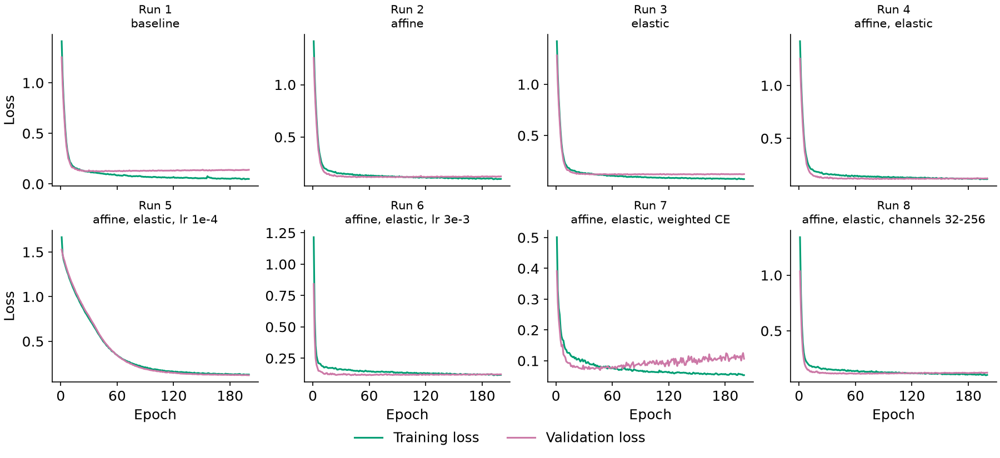
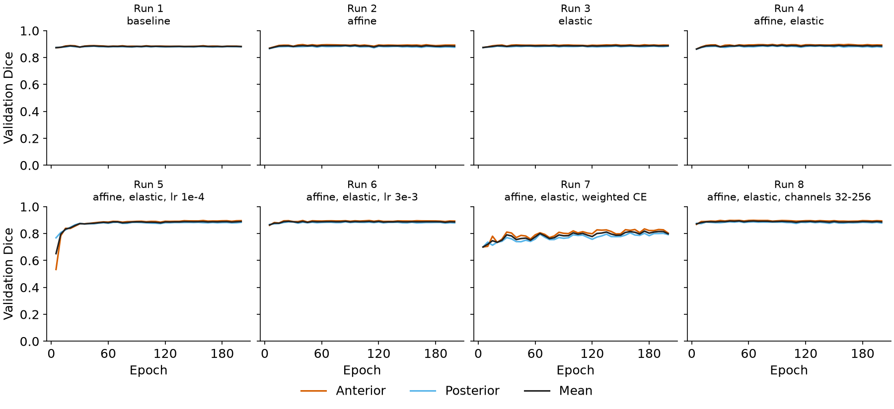
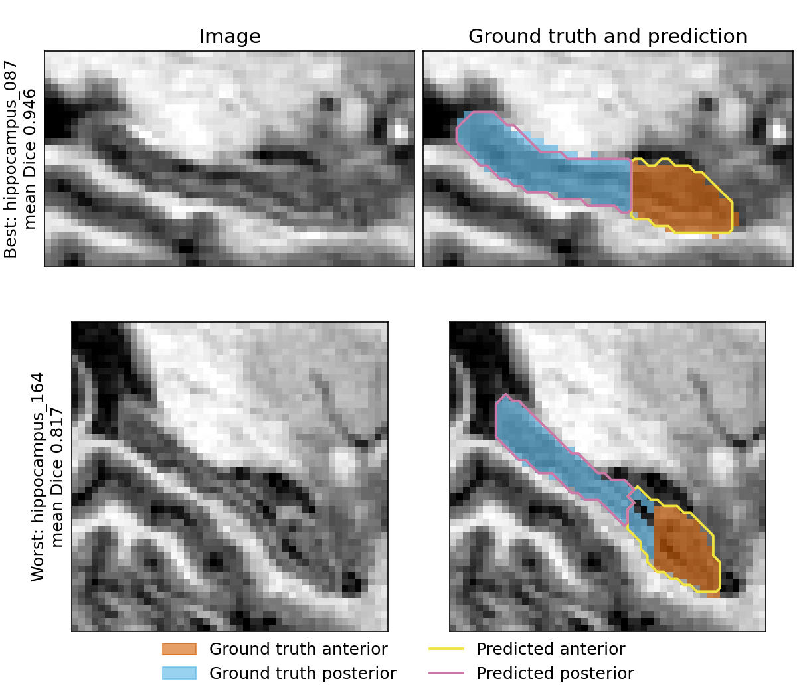

# Hippocampus segmentation with a 3D Attention U-Net (MSD Task04)

This project segments the anterior and posterior hippocampus in brain MRI using a 3D Attention U-Net trained on random patches with a Dice + cross-entropy loss. A controlled ablation study of 8 runs measures how augmentation, learning rate, loss function and network width affect performance. The final model, chosen by validation Dice, reaches a **test mean Dice of 0.889 ± 0.037** (anterior 0.896, posterior 0.882) across 39 held-out cases.

All code is in one notebook, [`hippocampus_attention_unet.ipynb`](hippocampus_attention_unet.ipynb), which runs from top to bottom.

## Dataset

The data is [Task04 Hippocampus](http://medicaldecathlon.com/) from the Medical Segmentation Decathlon: 260 labelled T1-weighted MRI volumes of roughly 35 × 50 × 35 voxels at 1 mm isotropic spacing. Labels are 0 = background, 1 = anterior and 2 = posterior. Foreground is about 5 % of all voxels. The unlabelled `imagesTs` folder is not used.

**Split.** Cases are split about 70 / 15 / 15 % into 182 train, 39 validation and 39 test cases, by subject rather than by case. The dataset publishes no subject IDs, but consecutive IDs (001-002, 003-004, ...) are two crops of one brain scan, so subject = `(case number + 1) // 2`. Both cases of a subject always go to the same set. The split is fixed in [`splits/split.json`](splits/split.json).

**Licence and citation.** The dataset is licensed under [CC-BY-SA 4.0](https://creativecommons.org/licenses/by-sa/4.0/). The MRI slices shown in `figures/qualitative_cases.png` are derived from it and are shared under the same licence. Please cite:

> Antonelli, M., Reinke, A., Bakas, S., et al. *The Medical Segmentation Decathlon.* Nature Communications 13, 4128 (2022).
>
> Simpson, A. L., Antonelli, M., Bakas, S., et al. *A large annotated medical image dataset for the development and evaluation of segmentation algorithms.* arXiv:1902.09063 (2019).

## Method

**Preprocessing.** Volumes are reoriented to RAS, z-score normalised per volume over non-zero voxels, and padded to at least the patch size. Voxel spacing is consistent across all 260 cases, so no resampling is applied.

**Patch sampling.** Training uses random 32 × 32 × 32 patches with foreground-balanced sampling (`RandCropByPosNegLabeld`), 4 patches per volume and 16 patches per batch.

**Network.** MONAI `AttentionUnet` in 3D, with channels (16, 32, 64, 128), strides (2, 2, 2), and about 1.47 million parameters. Attention gates re-weight each skip connection using a gating signal from the coarser decoder level ([Oktay et al. 2018](https://arxiv.org/abs/1804.03999)).

**Loss and training.** The baseline loss is equally weighted Dice + cross-entropy, with Adam at a learning rate of 1e-3. Every run trains for a fixed 200 epochs with no early stopping, on an NVIDIA L4 GPU with mixed precision. Validation uses sliding-window inference on full volumes (50 % overlap). Validation Dice is measured every 5 epochs, and the checkpoint with the best mean validation Dice is kept.

**Augmentation (training patches only).** Each transform is applied with probability 0.5:
- Affine: rotation ±15°, scale 0.9–1.1, translation ±3 voxels.
- Elastic: mild settings (sigma 6–8, magnitude 50–120), because the structures are small.

Images use trilinear interpolation and labels use nearest-neighbour.

## Results

Dice excludes background. Test values are mean ± standard deviation across the 39 test cases. Runs 2–4 test augmentation on the baseline. Runs 5–8 each change one factor from the best augmentation setting, chosen by validation Dice only.

| Run | Configuration | Val mean Dice | Test anterior | Test posterior | Test mean |
|---|---|---|---|---|---|
| 1 | Baseline (no augmentation) | 0.887 | 0.896 ± 0.039 | 0.882 ± 0.040 | 0.889 ± 0.037 |
| 2 | Affine | 0.890 | 0.894 ± 0.039 | 0.880 ± 0.043 | 0.887 ± 0.039 |
| 3 | Elastic | 0.890 | 0.900 ± 0.039 | 0.877 ± 0.040 | 0.889 ± 0.037 |
| 4 | Affine + elastic | 0.892 | 0.900 ± 0.039 | 0.881 ± 0.039 | 0.891 ± 0.037 |
| 5 | Affine + elastic, lr 1e-4 | 0.890 | 0.900 ± 0.039 | 0.881 ± 0.039 | 0.890 ± 0.036 |
| 6 | Affine + elastic, lr 3e-3 | 0.891 | 0.898 ± 0.036 | 0.880 ± 0.038 | 0.889 ± 0.035 |
| 7 | Affine + elastic, class-weighted CE | 0.819 | 0.844 ± 0.037 | 0.808 ± 0.033 | 0.826 ± 0.033 |
| **8** | **Affine + elastic, channels 32–256 (final model)** | **0.894** | **0.896 ± 0.038** | **0.882 ± 0.041** | **0.889 ± 0.037** |

Training and validation loss for each run:



Validation Dice for each run:



Best and worst test cases for the final model, with ground truth filled and predictions outlined:



## Ablation findings

- **Most settings made no measurable difference.** Runs 1–6 and 8 span only 0.004 in test mean Dice, far less than the 0.037 standard deviation between cases. The "best" settings carried forward were chosen on validation differences of a few thousandths, so they should not be read as real improvements.
- **Augmentation reduced overfitting but did not raise Dice.** The final-epoch gap between training and validation loss falls from 0.09 without augmentation (run 1, whose best epoch was 20) to under 0.01 with affine + elastic (run 4).
- **Learning rate affected speed, not the end result.** At 1e-4 the model learned much more slowly and reached its best validation Dice at the final epoch, yet ended level with 1e-3 and 3e-3.
- **Class-weighted cross-entropy was clearly worse.** It lost about 0.065 test Dice compared with run 4, and its validation loss rose after about epoch 50.
- **A wider network did not help.** Quadrupling the parameters (run 8) gave no test benefit.

**Failure modes.** Test scores for the final model range from 0.817 to 0.946, and 7 of the 39 cases fall below 0.85. In the worst case shown above, the overall outline is good but the boundary between anterior and posterior is misplaced, with the predicted anterior extending into the ground-truth posterior.

## How to run

The notebook picks its mode automatically, so no code needs editing. It runs in `full` mode on a Colab kernel with a GPU and in `dev` mode on any other kernel. The environment variable `HIPPO_MODE=dev|full` overrides this.

| | `dev` (local CPU) | `full` (Colab GPU) |
|---|---|---|
| Data | 20 train / 5 val / 5 test cases | Full split (182 / 39 / 39) |
| Epochs | 3 | 200 |
| Outputs | `outputs/dev/` | `outputs/full/` on Google Drive |

Both modes use the same transforms, network, loss, patch size, split and seeds.

**Getting the data.** Download `Task04_Hippocampus.tar` from the [Medical Segmentation Decathlon](http://medicaldecathlon.com/) and extract it. The notebook does not download it for you.

**Google Colab.** Put the extracted folder in Google Drive at `MyDrive/decathlon/data/Task04_Hippocampus`, then open the notebook in Colab, select a GPU runtime and run all cells. The notebook mounts Drive, copies the data to the runtime once per session and saves results to `MyDrive/decathlon/outputs/full/`. If the runtime disconnects, run all cells again: finished runs are skipped, so only the run in progress is lost.

**VS Code with the Colab extension.** Open the notebook locally and choose a Colab GPU kernel from the Google Colab extension. It then behaves exactly as above.

**Local set-up (dev mode).**

```bash
python -m venv .venv
source .venv/bin/activate      # Windows: .venv\Scripts\activate
pip install -r requirements.txt
pip install ipykernel
```

Put the extracted data at `data/Task04_Hippocampus` in the project folder, select the `.venv` kernel and run all cells.

The results in this README were produced on Colab with Python 3.13, using the library versions in `requirements.txt`. The saved notebook output comes from the last resumed Colab session, so runs 1–6 appear there as already finished.

## Limitations and future work

- **One split and one seed.** Differences of a few thousandths cannot be separated from random variation. Repeating runs across seeds or cross-validation folds would show which differences are real.
- **Inferred subjects.** Subject identity is inferred from the pattern of case IDs because the dataset does not publish it.
- **Narrow data.** All cases are pre-cropped around the hippocampus and come from a single dataset, so performance on whole-brain scans or other scanners is untested.
- **Dice only.** Boundary-distance metrics such as HD95 are not reported.
- **Attention not isolated.** Without a plain 3D U-Net comparison, this study cannot say how much the attention gates contribute.
- **Future work.** Natural next steps are multiple seeds, HD95, a plain U-Net baseline, and a border-weighted loss to target the anterior/posterior boundary.
